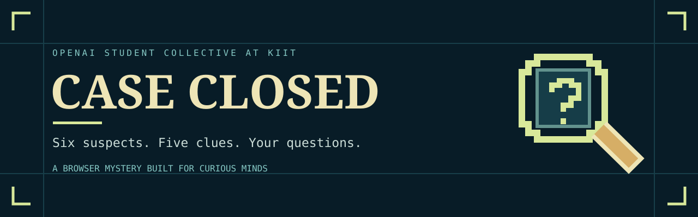
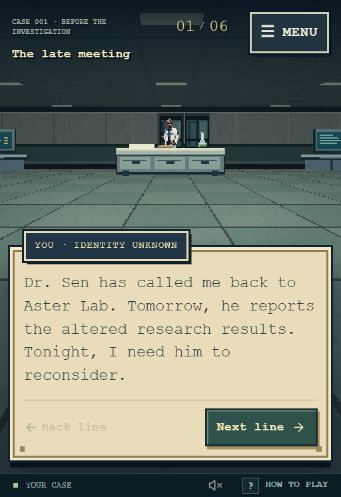
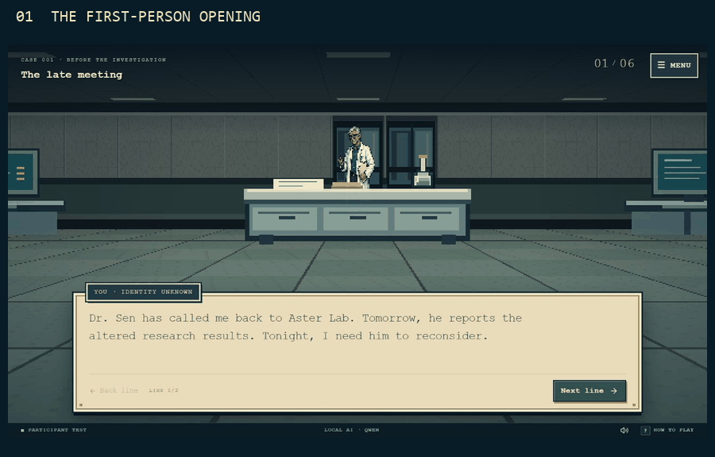
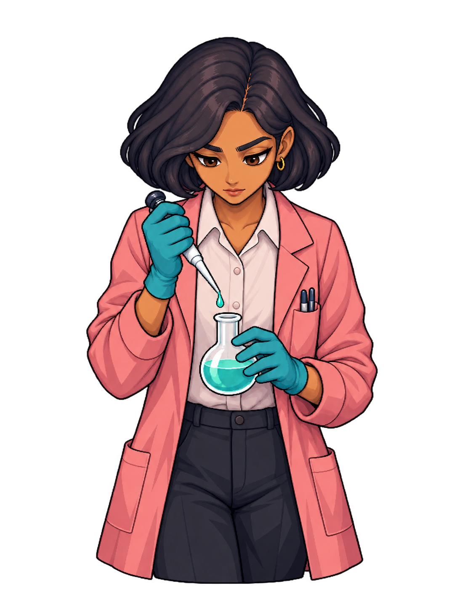
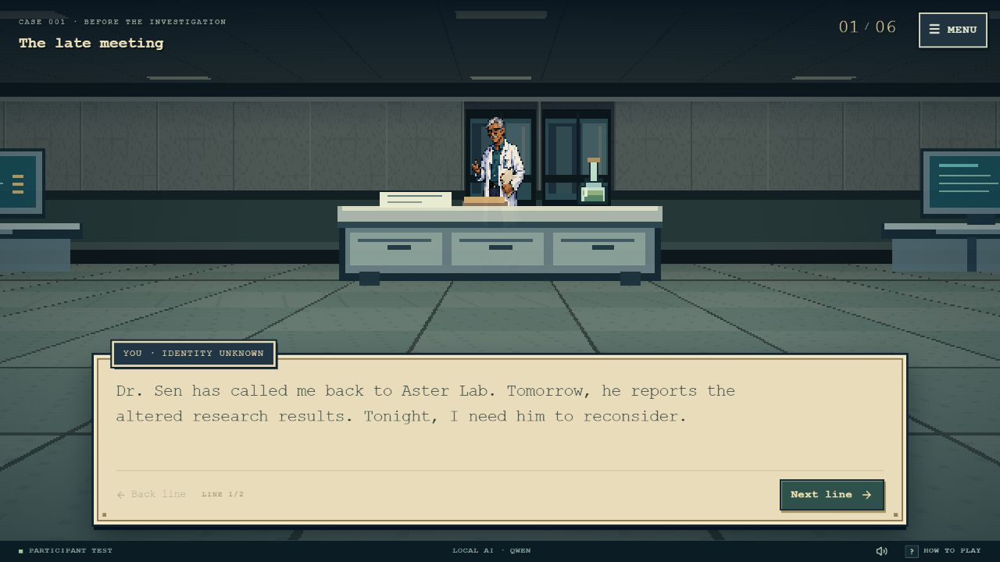
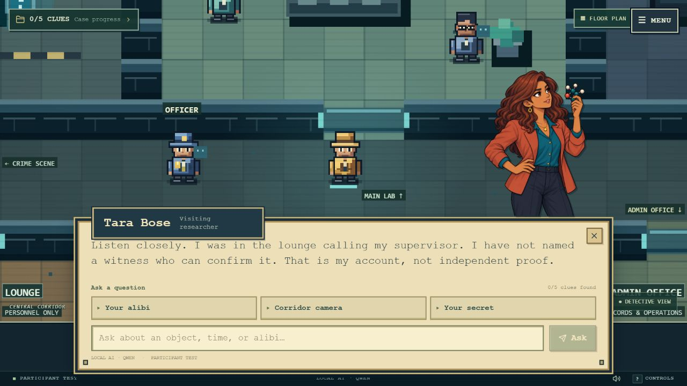
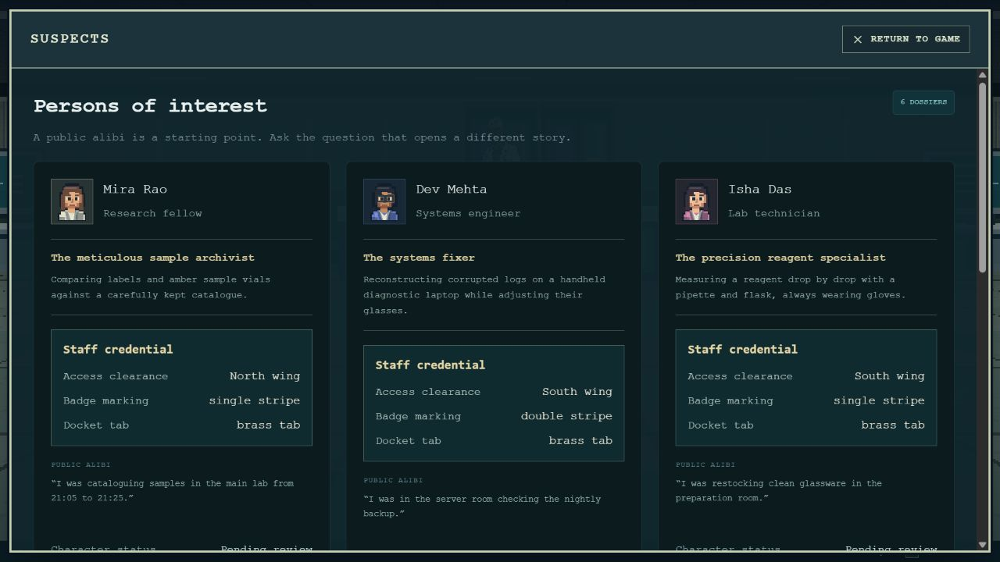
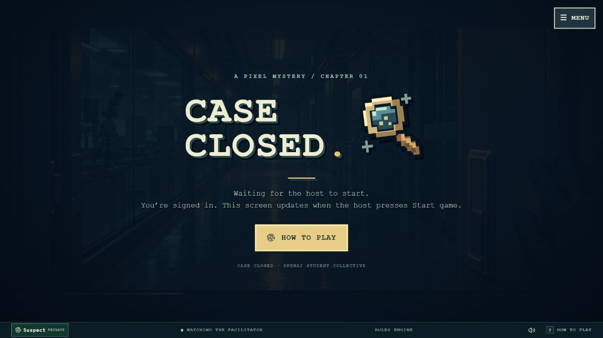

<p align="center">
  
</p>

<p align="center">
  <a href="https://case-closed-kiit.ashmitavash.chatgpt.site/">Play the hosted game</a> ·
  <a href="docs/downloads/Case-Closed-Project-Description.docx">Download the project description</a> ·
  <a href="docs/development.md">Run it yourself</a> ·
  <a href="docs/workshop.md">Host a workshop</a>
</p>

<p align="center">
  <a href="https://github.com/Kenshi0905/case-closed/actions/workflows/ci.yml"></a>
  <a href="LICENSE"></a>
  
  
</p>

## Six suspects. One case of your own.

Dr. Sen is dead. Six people have an explanation. The evidence has its own story.

**Case Closed** is a pixel-art browser mystery created for **OpenAI Student Collective at KIIT**. The public game is now a solo mystery: play a choice-driven first-person opening, explore the lab, question six suspects and make your accusation. The original live workshop has finished; its facilitator and character-writing tools remain available for optional reuse. Ask questions, test an alibi and decide which details actually support your conclusion.

The main game runs on **character-aware scripted dialogue**. No local model, paid API key or laptop AI server is needed to play. Optional Qwen integration remains available for self-hosted experiments.

<p align="center"></p>
<p align="center"><sub>Current solo opening. Your choices move the anonymous character; you take control of the detective after the prologue.</sub></p>

<p align="center"></p>
<p align="center"><sub>A tour of real workshop screenshots, not a gameplay recording. Historical images may show the former Local AI label.</sub></p>

## Inside the case

| Feature | What you experience |
| --- | --- |
| **A first-person opening** | Choices guide an anonymous character through an original pixel-rendered 2.5D laboratory. Automatic movement, object-focused camera turns and Dr. Sen's portrait establish the scene. |
| **Optional workshop writing** | Five or six writers get six minutes to develop structured alibis, personalities, relationships and private secrets. Facilitators review the result. |
| **Optional shared investigation** | One facilitator moves the detective while the audience follows the same discoveries and conversations. The roster supports up to 50 participants. |
| **Your own investigation** | Start without signing in. Each browser session receives its own case and approved default cast, with no writing timer or host wait. |
| **Grounded conversations** | Free-text questions are matched to permitted facts. Unknown times remain unknown. An alibi is a claim, not proof. |
| **Evidence-led deduction** | A watch, flask, access records, camera fragment and folded note connect timing and anonymous staff attributes. Ordinary clues do not simply print the killer's name. |
| **Private information with boundaries** | Suspects have distinct roles and secrets; targeted evidence and follow-up questions govern disclosure. The culprit stays sealed until the reveal. |
| **A game-sized interface** | Large character portraits, bottom dialogue boxes, keyboard movement, original synthesized SFX, mute and reduced-motion support. |
| **Voting and replay** | The room accuses, hears the explanation and discusses its reasoning. Published replays preserve a case without needing the original model computer. |

## Meet the suspects

<table>
<tr>
<td align="center"><br><b>Mira Rao</b><br>Research fellow</td>
<td align="center"><br><b>Dev Mehta</b><br>Systems engineer</td>
<td align="center"><br><b>Isha Das</b><br>Lab technician</td>
</tr>
<tr>
<td align="center"><br><b>Kabir Sethi</b><br>Grant coordinator</td>
<td align="center"><br><b>Tara Bose</b><br>Visiting researcher</td>
<td align="center"><br><b>Neil Kapoor</b><br>Doctoral candidate</td>
</tr>
</table>

These are the default identities. Solo play uses the default accounts. Optional approved workshop writing supplies custom accounts and voice. A character's occupation does not automatically give them first-hand knowledge of every clue.

## Responsive dialogue without inference

The scripted engine uses weighted intent rules, spelling aliases, same-character follow-ups, bounded retrieval of approved public sentences and a finite personality bank. It gives specific answers when context supports them and asks for clarification when it does not.

> **“Where were you?”** → the suspect's approved alibi.  
> **“What time was your call?”** → the authored call time, or an explicit admission that it was not supplied.  
> **“Did you see the watch break?”** → personal knowledge, not a forensic report recited by every character.  
> **“Tell me your secret.”** → no instant confession; evidence and a meaningful follow-up are required.

The server owns the facts, permissions, clue access and solution. Scripted play does not poll the local-model relay, wait for generation or pretend to be a live language model. [Read the conversation design →](docs/dialogue.md)

<details>
<summary><b>Can I still try Qwen?</b></summary>

Yes. The optional adapter, relay, status monitor, Windows launchers, configuration helper and tests are retained. The original experiment used Qwen2.5 1.5B Instruct via llama.cpp and Vulkan. The model selects among permitted deliveries; it does not decide the truth of the case.

For your own deployment, configure the server to allow local AI and explicitly select it in facilitator controls. Failure or timeout falls back to the scripted answer. Model weights, runtime binaries, credentials and the original host's logs are excluded from Git.

[Set up optional local AI →](local-ai/README.md)
</details>

## Play or run locally

**Hosted:** [Play Case Closed](https://case-closed-kiit.ashmitavash.chatgpt.site/), then click **PLAY CASE CLOSED**. No email, facilitator or local model is required. Complete the opening, select **Begin investigation**, collect five clues, question the cast and choose **Make your accusation** in Case progress. Your case resumes on refresh while its 24-hour browser session remains valid. **Start a new case** in the menu creates a fresh investigation.

For the optional workshop, open `?workshop=1`. The reserved `testuser@gmail.com` login retains its full six-minute participant-test flow; it never grants administrator access.

**Local:** Node.js 22.13+, npm and Git. Install and build, initialize the local D1 schema, then start the preview:

```sh
git clone https://github.com/Kenshi0905/case-closed.git
cd case-closed
npm run install:ci
npm run build
# Initialize a fresh local DB using the two commands in docs/development.md.
npm run dev
```

[Complete setup, migrations and hosting notes →](docs/development.md)

## Built to teach as well as play

| Game mechanic | Learning opportunity |
| --- | --- |
| Structured character writing | Context engineering: a useful answer starts with useful source material. |
| Personal account vs inspected evidence | Grounding, source attribution and uncertainty. |
| Staged secrets and separate roles | Authorization, privacy and server-enforced information boundaries. |
| Optional Qwen, saved answers and scripts | Model output vs application logic; caching and fallback design. |
| Shared scene, frozen case and replay | State synchronization, reproducibility and evaluation. |
| Accusation and debrief | Judging claims by evidence rather than confidence or tone. |

**Astra's role:** a development collaborator used through Codex to implement, debug, test and document the changing specification. It is not called for every in-game question. Ashmit directed the experience and workshop; Gourav co-led the session. Original character artwork was created with image tools.

## Documentation and downloads

- [**Case Closed project description (.docx)**](docs/downloads/Case-Closed-Project-Description.docx) — the supplied illustrated workshop document, with the Collective letterhead and feature-by-feature learning outcomes. Preserved as a historical October 9 document: it refers to the former eight-minute period and local-AI-led setup. **Current public play is solo and scripted; optional workshop writing lasts six minutes.**
- [Workshop guide](docs/workshop.md) — start checklist, phase controls, voting and known operational limits.
- [Development guide](docs/development.md) — architecture, local setup, database and hosting.
- [Dialogue design](docs/dialogue.md) — response selection and disclosure rules.
- [Optional local AI](local-ai/README.md) — retained integration and original measurements.
- [Art provenance](THIRD_PARTY_NOTICES.md) — source and licensing of assets and dependencies.

<details>
<summary><b>More screenshots</b></summary>

### The opening


### An interview


### Suspect dossiers


### Waiting for the host


Screenshots are archived workshop captures; they illustrate the experience rather than certify the current live event state.
</details>

## Contributing and verification

```sh
npm test
npm run typecheck
npm run check:public
npm run build
```

The test suite covers all six suspects, evidence gates, cache boundaries, roles, deadlines, movement, replay isolation and optional model failure paths. CI runs on pushes and pull requests. See [CONTRIBUTING.md](CONTRIBUTING.md) and [SECURITY.md](SECURITY.md).

This is a workshop project, not a claim that every free-text question or deployment configuration has been verified. Participant email entry is self-identification, not mailbox verification. A fork must provide its own trusted host identity and database. The main game still needs its web server and database; “no model required” does not mean offline hosting.

## License and credits

Original code and documentation are released under the [MIT License](LICENSE). Bundled dependencies retain their licenses; generated media and identifying marks are explained in [Third-party notices](THIRD_PARTY_NOTICES.md). No commercial-game ROMs, WADs, code or audio are included.

Created by **Ashmit Avash**, with **Gourav Dutta**, for **OpenAI Student Collective at KIIT**. A student-led project; the names and logos in workshop materials do not imply an official product endorsement.
